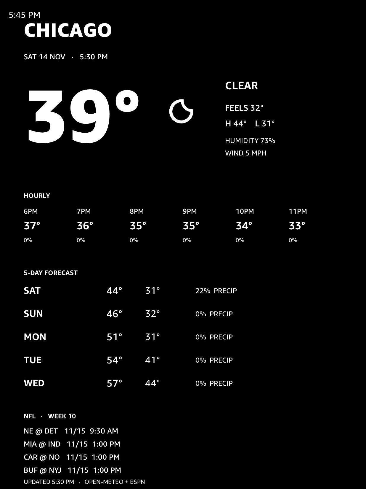

# Kindle E-Ink Weather Dashboard

A clean, Swiss-typographic weather dashboard for a **jailbroken Kindle Paperwhite
(11th gen / PW5, 1236×1648 E-Ink)**. It fetches live weather from the free
[Open-Meteo](https://open-meteo.com) API and renders it on-device with crisp
TrueType type — no app, no cloud service, just shell scripts and tools already
present on a jailbroken Kindle.

<p align="center"><br><sub>Black-on-white "paper" look: city, current temperature + weather icon, hourly row, 5-day forecast</sub></p>

## Features
- Current temperature, condition, feels-like, hi/lo, humidity, wind
- Day/night weather **icons** (Nerd Font glyphs)
- Hourly forecast (next 6 hours) and a 5-day forecast
- **Auto-refresh** every 30 min, with an offline cache fallback (shows last-known
  data if Wi-Fi drops)
- **Always-on** dedicated-display mode (keeps the dashboard on screen)
- Runs entirely on the Kindle — your Mac doesn't need to stay on

## How it works
The data layer and the view layer are deliberately separate, so you can restyle
without touching the fetch logic:

```
curl ──► cache/weather.json ──► luajit parse.lua ──► cache/data.env ──► render.sh ──► screen
 (fetch)      (raw API)          (JSON → values)        (KEY=VALUE)       (FBInk TTF)
```

- **`bin/fetch.sh`** — `curl` the Open-Meteo API, cache the JSON atomically.
- **`bin/parse.lua`** — decode the JSON with **luajit** (plus a tiny bundled
  `assets/json.lua`), compute display values (rounding, weekday names, icon
  codepoints), emit a flat `KEY=VALUE` file.
- **`bin/render.sh`** — lay the values out on a grid using **FBInk**'s TrueType
  rendering (`fbink -t`). Change this file to change the design.
- **`bin/dashboard.sh`** — orchestrates fetch → parse → render with cache fallback.
- **`bin/dashboard-loop.sh`** — background auto-refresh + keeps the screen on.
- **`bin/kindle-ui.sh`** — stop/start the Kindle UI framework for a stable,
  touch-proof dedicated display.

## Requirements
- A **jailbroken** Kindle (developed on a Paperwhite 11th gen / PW5, firmware 5.18.2).
  See [kindlemodding.org](https://kindlemodding.org).
- **KOReader installed** on the Kindle — this project reuses tools it bundles:
  `luajit` (`/mnt/us/koreader/luajit`) and the Nerd Font (`.../fonts/nerdfonts/symbols.ttf`).
- **FBInk** on the Kindle, symlinked to `/usr/local/bin/fbink` (KOReader bundles one;
  text/TrueType support is enough — image support is not required here).
- **curl** with HTTPS (present on recent Kindle firmware).
- SSH access to the Kindle over Wi-Fi (e.g. via [Jobman](https://kindlemodding.org)).

## Setup
1. Clone this repo on your computer.
2. Edit **`config.sh`** — set your latitude/longitude, units, and timezone.
3. Point the deploy at your Kindle and push:
   ```sh
   export KINDLE_HOST=root@<your-kindle-ip>
   ./deploy.sh
   ```
   (Jobman runs sshd in a chroot that blocks key auth, so `scp`/`ssh` will prompt
   for the Kindle's SSH password — the Jobman default is `kindle`.)
4. On the Kindle: `fbink` must resolve. If it doesn't:
   `ln -sf /mnt/us/koreader/fbink /usr/local/bin/fbink`

## Usage (on the Kindle, over SSH)
```sh
/mnt/us/dashboard/bin/dashboard.sh              # draw once (fetch + render)
/mnt/us/dashboard/bin/dashboard-loop.sh start   # auto-refresh + keep on screen
/mnt/us/dashboard/bin/dashboard-loop.sh stop    # stop + re-enable screensaver
/mnt/us/dashboard/bin/dashboard-loop.sh status  # running?
/mnt/us/dashboard/bin/kindle-ui.sh stop         # dedicated mode (touch-proof)
/mnt/us/dashboard/bin/kindle-ui.sh start        # back to a normal Kindle
```
Change the refresh interval: `REFRESH_MIN=60 .../dashboard-loop.sh start`.

## Configuration (`config.sh`)
Location (`LAT`/`LON`/`TZ_NAME`), units (`TEMP_UNIT`/`WIND_UNIT`/`PRECIP_UNIT`),
how many hourly columns and NFL games to show, fonts, and all on-device paths.

## Notes & limitations
- **Dark mode:** the device's global dark mode inverts the panel; the design is
  black-on-white, so it shows white-on-black in dark mode. Both look fine.
- **Dedicated mode** stops the Kindle UI framework (reversible with `kindle-ui.sh
  start` or a reboot) so touches don't jump to home and nothing repaints over it.
- **Auto-start on boot** is not set up — re-run the loop after a reboot.
- Battery: keeping the screen on + periodic Wi-Fi wakes lasts days, not weeks, on
  a charge; best left on a charger for an always-on desk display.

## Credits & inspiration
- **Weather data:** [Open-Meteo](https://open-meteo.com) — free, no API key.
- **E-Ink rendering:** [FBInk](https://github.com/NiLuJe/FBInk) by NiLuJe.
- **Fonts:** Amazon Ember (on-device) for type; weather glyphs from
  [Nerd Fonts](https://www.nerdfonts.com/) (Weather Icons by Erik Flowers).
- **JSON parsing:** luajit (bundled with KOReader) + a tiny vendored `json.lua`.
- **Jailbreak & tooling:** the [KindleModding](https://kindlemodding.org) community
  (KPM, Jobman, KOReader).
- Developed with **Claude Code**.

## License
MIT — see [LICENSE](LICENSE). Not affiliated with Amazon or Open-Meteo.
